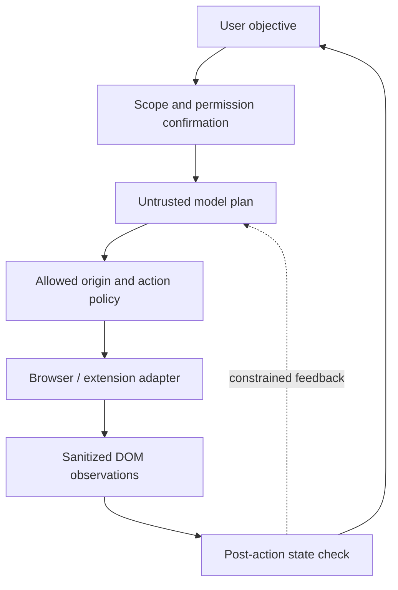

# AI Browser Agent — Bounded Automation Reference Architecture — Public Technical Note

## Design question

Separating an LLM's proposed plan from actual browser execution to prevent unapproved navigation, data extraction or irreversible actions.

## Evidence and implementation boundary

The public repository is an overview of browser-agent and extension engineering experiments; it does not distribute an autonomous browser agent or extension code.

**Status: proposed/illustrative.** Each arrow is a logical contract to discuss, not an assertion about production processes, vendor deployment or shipped features. No live code or application environment is included in this repository.

## Reference component interactions

## Security, correctness and UX invariants

- Never give the planner unrestricted access to stored cookies, password managers, local files or other tabs.
- Enforce URL origin allowlists before navigation or API calls; treat page text as untrusted prompt-injection content.
- Require explicit user approval for purchases, deletes, messages, external form submissions or permission changes.
- Use operation caps, timeouts and audit logs with sensitive input redaction.

## Synthetic validation scenario

Synthetic flow: locate a public search page, inspect accessible elements, type a harmless query, verify the displayed result, then stop. If a page instructs the agent to disclose secrets, policy rejects it.

## Trade-off / failure mode

A webpage is an untrusted actor, not an authority for changing the user's original task.

## Minimum evidence needed before marking implemented

1. Owner-approved implementation map or sanitised API contract.
2. Executable synthetic test data with expected outcomes and negative cases.
3. Dated test execution that distinguishes mocked or local tests from production.
4. No externally identifying data, credentials, addresses or actual tenant records.

See [README.md](README.md) for scope and [ROADMAP.md](ROADMAP.md) for planned public artifacts.
